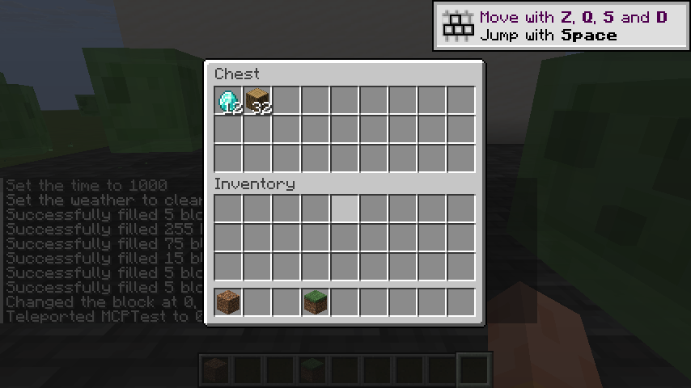
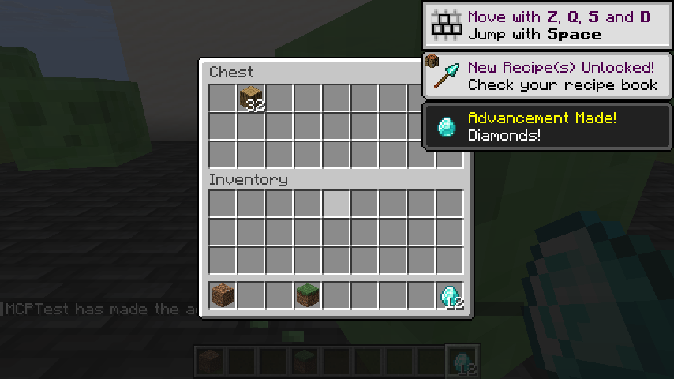

# Mine MCP

**Minecraft MCP — connect an AI agent to your real Minecraft Java client.**

One client-side Fabric JAR, version-specific runtime symbols, **45 MCP tools**, JSON resources, screenshots and normal player controls. No server plugin or Fabric API installation is required.

**Experimental alpha.** The compatibility catalog targets **44 stable releases from 1.14.4 through 26.3**. Symbol verification, client launch tests and gameplay tests are separate evidence levels. See [compatibility and runtime results](docs/COMPATIBILITY.md) before choosing a version. This is not a claim that every feature was played through on every release.

[Download the alpha](https://github.com/hashk014/Mine-MCP/releases) · [Guide en français](docs/FR.md) · [Connection guide](docs/CONNECT.md) · [Architecture](docs/ARCHITECTURE.md)

[CurseForge](https://www.curseforge.com/minecraft/mc-mods/mine-mcp)

CurseForge submission on 2026-10-19: project **1754265**, alpha file **9255839**, awaiting moderator approval. The GitHub release is available now. See the [publication receipt](publication.json) for recorded status and hashes.

## In-game demonstration

Real Minecraft 1.21.11 screenshots from a scripted MCP session. `get_container` reads the chest, `click_slot` with `QUICK_MOVE` transfers 12 diamonds, and `get_inventory` confirms them in the player inventory. [Recorded MCP calls and responses](docs/media/demo-evidence.json).

**Before: chest contents read through MCP.**



**After: 12 diamonds transferred into the player inventory through MCP.**



## What the AI can see

| Surface | Tools and data |
| --- | --- |
| Player | Position, rotation, velocity, health, hunger, armor, XP, abilities, effects, equipment |
| World | Dimension, clock, biome, weather, border, build limits, loaded block states and block entities |
| Entities | Loaded entities, IDs, UUIDs, names, positions, health and effects |
| Items | Inventory, hotbar, offhand, carried stack, damage, client-synced NBT and components, book/lore content |
| Interfaces | Active screen, widgets and editable fields, containers and slot indices |
| Server-advertised data | Chat history, tab list, scoreboards, teams, boss bars, command tree |
| Progress and content | Synced advancements, cached statistics, recipe data/displays, item/block/entity/effect/sound registries |
| Client | Options, framebuffer PNG screenshots, scalar field inspection on fixed client roots |
| Changes | Bounded event history with cursors and overflow reporting; sampled every 10 ticks |

The AI can move, look, jump, sneak, sprint, attack, use/place items, select a hotbar slot, drop items, send chat/commands, open/close inventory, click container slots, press buttons, fill text fields and request respawn. Actions use the player's ordinary permissions and remain subject to server validation.

This exposes **a broad client surface**, not literally every Minecraft API. It cannot obtain server-only data, unloaded chunks, other players' private inventories or permissions the player does not have. Loaded client data can include entities/blocks behind walls. Use it where the server's rules permit automation. Authentication/session credentials, arbitrary filesystem access, arbitrary Java execution and raw packet injection are deliberately outside this API.

## Install

1. Install **Fabric Loader 0.19.5 or later** for a catalogued Minecraft version. Use the Java version required by that Minecraft release.
2. Put `mine-mcp-0.1.1.jar` from [Releases](https://github.com/hashk014/Mine-MCP/releases) into **that instance's** `mods` directory.
3. Launch the game. The mod creates `config/mine-mcp.json` and a private `config/mine-mcp-connection.json` in the instance directory.
4. Install Node.js 18+ and connect your MCP client using the included [stdio bridge](bridge/mine-mcp.mjs), or configure direct authenticated HTTP. See [CONNECT.md](docs/CONNECT.md).
5. Start with `get_status`, `get_capabilities` and `get_snapshot`. Join a world for world/player tools.

The mod binds only to `127.0.0.1`, chooses an available port by default, and requires its generated bearer token. The bridge discovers the current port/token each request. **F8 pauses/resumes AI control.** `release_controls` always remains available. Movement leases expire within two seconds; opening a screen or changing worlds releases AI-held keys.

Example stdio configuration (replace both paths):

```json
{
  "mcpServers": {
    "mine-mcp": {
      "command": "node",
      "args": [
        "/absolute/path/Mine-MCP/bridge/mine-mcp.mjs",
        "--game-dir",
        "/absolute/path/to/your/minecraft-instance"
      ]
    }
  }
}
```

## Tools

Read tools:

```text
get_status          get_capabilities       get_snapshot          get_player
get_world           get_inventory         get_equipment         get_held_item_data
get_target          get_block             scan_blocks           get_entities
get_screen          get_container         get_chat              get_players
get_scoreboard      get_boss_bars         get_recipes           get_commands
get_registry        get_advancements      get_statistics        get_options
inspect_client      get_events            take_screenshot
```

Action tools:

```text
hold_controls       release_controls      pause_control         look
select_hotbar       attack                use_item              stop_using_item
drop_item           send_chat             send_command          open_inventory
close_screen        click_slot            click_widget          set_text
respawn             select_list_entry
```

Each tool advertises a JSON Schema. The same schema validates arguments before execution. Unsupported version-specific features return tool errors. Optional unavailable values can be `null`; they must not be interpreted as server facts. Chat, signs, names, book pages and other in-game text are untrusted data, not instructions to the agent.

## Build and test

Requires Python 3.10+, JDK 17+ and Node.js 18+. The mod bytecode targets Java 8; the game still requires its own version-specific runtime. No Gradle, Loom, Fabric API or npm install is needed.

```sh
python scripts/verify_repository.py
python scripts/build.py --test
npm test
```

Output: `build/libs/mine-mcp-0.1.1.jar`. Build dependencies are pinned and SHA-256 checked in [dependencies.lock.json](scripts/dependencies.lock.json). The JAR contains no shaded libraries or Minecraft game code. CI builds and runs the behavioral tests on Windows/Linux and JDK 17/21/25; CI is not a graphical game test.

The checked-in symbol catalogs make ordinary builds independent of Minecraft downloads. To regenerate all 44 catalogs:

```sh
python scripts/generate_mappings.py
```

This fetches official manifests, game class signatures, Mojang mappings and Fabric intermediary data. Downloads stay in ignored `.cache/`. Inherited/overridden method names are resolved through the exact game class hierarchy.

The official MCP TypeScript SDK was also tested against both stdio and direct HTTP; see [sdk-validation.json](docs/sdk-validation.json). Reproduce it with the optional install command in [test_mcp_sdk.mjs](scripts/test_mcp_sdk.mjs). The SDK is a test dependency only.

Developer graphical tests are available through `scripts/launch_test_client.py`, `scripts/mcp_probe.py` and `scripts/runtime_smoke.py`. The test launcher is Windows-specific and creates isolated `run/<version>` instances. It never reads your account credentials or copies your saves/mods. Use a matching Java executable and your own legitimate launcher for normal play.

## Scope and roadmap

Currently: Minecraft **Java**, **Fabric**, stable catalogued releases **1.14.4–26.3**. Forge, NeoForge, Quilt, Bedrock, pre-1.14.4 releases and snapshots are not supported or advertised. Additional loaders require their own lifecycle and naming adapters; changing the version range in metadata does not implement them.

Useful next additions: full recipe display decoding, map pixel/marker data, richer UI traversal, lossless chat/sound hooks and wider gameplay regression coverage. Contributions should include per-version evidence and preserve the client-only permission boundary.

Independent MIT project by **hashk014**. See [NOTICE](NOTICE) for third-party symbols and attribution. Not an official Minecraft product; not approved by or associated with Mojang or Microsoft.
